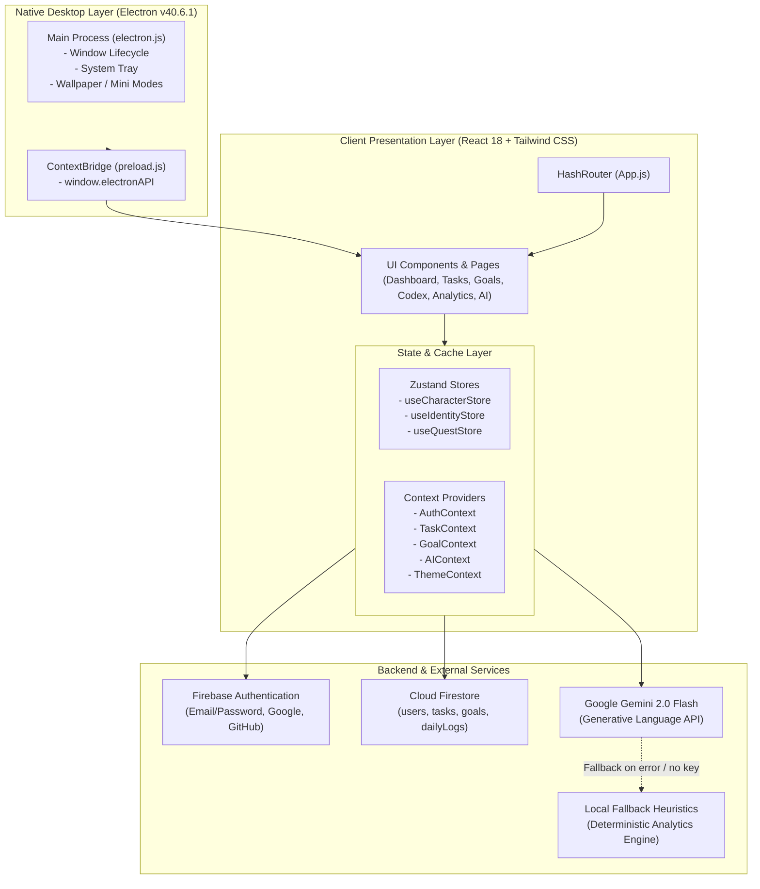
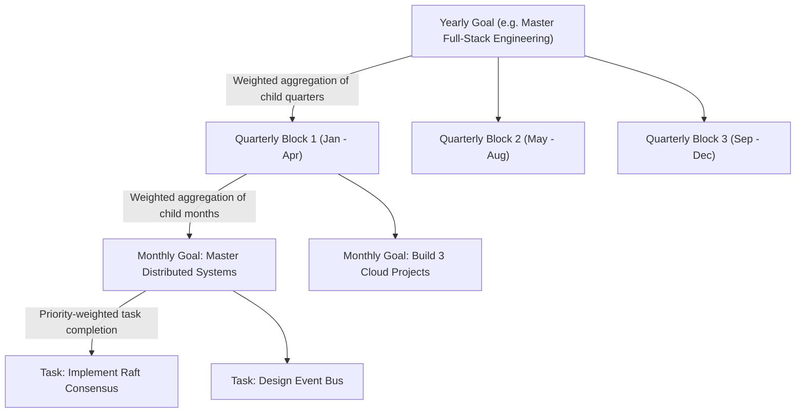

# FlowState (Execution OS) — Complete Project Architecture & Documentation

## 1. Executive Summary & Vision

**FlowState** (internally structured as `daily-tracker` v2.0.0 and branded as **Execution OS**) is a dual-target, cross-platform personal productivity and execution intelligence operating system. Built as a high-performance web application (React 18) and a specialized native desktop client (Electron 40), FlowState transforms mundane to-do lists into an immersive **Personal Execution Intelligence System (PEIS)**.

### Core Philosophy
1. **Gamification with Stakes (RPG Engine)**: Real-world tasks are modeled as missions, quests, and boss battles. Success grants Experience Points (XP) and character leveling, while neglect or failure inflicts damage on Player Health Points (HP).
2. **Strategy-to-Execution Alignment (Goal Pyramid)**: 4-tier hierarchical cascading architecture connects daily micro-tasks to Monthly, Quarterly, and Yearly life targets with automated progress rollups and risk analysis.
3. **Data-Driven Intelligence (FlowState AI)**: Integrated with Google Gemini 2.0 Flash (`gemini-2.0-flash`), the system feeds 30-day task completion analytics, streak velocity, and priority execution rates into a personal AI productivity coach.
4. **Ambient Productivity (Electron Desktop Modes)**: The desktop app features **Wallpaper Mode** (a semi-transparent, full-screen background overlay) and **Mini Mode** (a pinned, compact floating widget) designed to keep goals in constant peripheral focus.

---

## 2. High-Level System Architecture

FlowState follows a decoupled, client-driven reactive architecture backed by Google Firebase services and Google Gemini Generative AI.



---

## 3. Technology Stack Breakdown

| Layer | Technology | Version | Purpose |
| :--- | :--- | :--- | :--- |
| **Runtime / Core** | React | `^18.2.0` | UI component library with Concurrent Mode support |
| **DOM Renderer** | React DOM | `^18.2.0` | Virtual DOM rendering |
| **Routing** | React Router DOM | `^6.8.0` | Hash-based routing (`HashRouter`) for Electron / Web parity |
| **Build Tooling** | Create React App (`react-scripts`) | `5.0.1` | React build pipeline, Babel, and Webpack integration |
| **Desktop Framework** | Electron | `^40.6.1` | Chromium + Node.js desktop application wrapper |
| **Desktop Bundler** | Electron Builder | `^26.8.1` | NSIS installer generation for Windows x64 |
| **Styling** | Tailwind CSS | `^3.2.4` | Utility-first responsive design & custom cyberpunk/RPG tokens |
| **Post-Processing** | PostCSS + Autoprefixer | `^8.4.21` / `^10.4.13` | CSS compilation and cross-browser vendor prefixing |
| **Data Visualization** | Recharts | `^2.4.3` | SVG-based responsive Area, Line, and Radar charts |
| **Iconography** | Lucide React | `^0.125.0` | High-clarity SVG icon system |
| **State Management** | Zustand | `^4.1.4` | High-frequency reactive store for character and quest models |
| **Context API** | React Context | Native | Hierarchical session state (Auth, Tasks, Goals, AI, Theme) |
| **Date Utilities** | Date-fns | `^2.30.0` | Date manipulation and range computation |
| **Backend & DB** | Google Firebase SDK | `^10.8.0` | Auth (OAuth/Email), Firestore real-time DB, Storage |
| **AI Engine** | Google Gemini API | `v1beta` / `2.0-flash` | LLM-based productivity coaching & daily audit |

---

## 4. Detailed Module Analysis

### 4.1. Gamified RPG Execution Engine (Character, Stats & Personas)

The RPG mechanics reside primarily in `src/stores/useCharacterStore.js`, `src/stores/useIdentityStore.js`, `src/stores/useQuestStore.js`, and `src/components/hud/`.

#### A. Character Progression & Level Formula
Experience points (XP) scale dynamically using a modified power curve:
$$\text{XP}_{\text{required}}(L) = \text{round}\left(120 \cdot L^{1.7} + 250 \cdot L\right)$$
where $L$ represents current level.
- Upon level-up, the player is awarded **+5 Attribute Points** to distribute across 5 primary RPG attributes.
- Level-up grants immediate full restoration of **Max HP**.

#### B. Vital Resource Gauges
- **Health Points (HP)**:
  $$\text{Max HP} = 100 + (\text{Discipline} \cdot 2) + (\text{Level} \cdot 5)$$
  Failing or abandoning tasks deals direct HP damage based on quest difficulty.
- **Focus Points (FP)**:
  $$\text{Max FP} = 100 + (\text{Knowledge} \cdot 3)$$
  Represents deep work endurance and cognitive focus limit.
- **Energy Points (EP)**:
  $$\text{Max EP} = 100 + (\text{Consistency} \cdot 2)$$
  Resource consumed when launching daily missions.

#### C. Character Attributes
- **Discipline**: Increases Max HP pool and resistance to burnout.
- **Knowledge**: Boosts Max FP and strategic planning effectiveness.
- **Creativity**: Scaled via work campaigns and complex problem-solving.
- **Leadership**: Amplified by multi-stakeholder or high-visibility projects.
- **Consistency**: Expands Max EP and sustains task streak momentum.

#### D. The 4 Archetype Identities
Users can switch between archetypes at will; each changes the dashboard theme class on `document.body` and grants specific passive perks:

| Identity | Theme / Color | Preferred Category | Coaching Tone | Passive Perk & Mechanic |
| :--- | :--- | :--- | :--- | :--- |
| **Vanguard** | Crimson (`#EF4444`) | Health & Vitality | Tough Love Commander | 2x XP on physical & health tasks; 15% faster focus recovery. |
| **Strategist** | Teal (`#0D9488`) | Learning & Systems | Analytical Mentor | Knowledge & Creativity grow 25% faster; +20 FP deep work capacity. |
| **Guardian** | Gold (`#D97706`) | Routine & Consistency | Calm Stoic | Habits consume 20% less EP; HP loss from failed tasks reduced by 30%. |
| **Executor** | Purple (`#9333EA`) | Campaign Work | Relentless Hustler | +50% damage against Campaign Bosses; +15% XP for critical work tasks. |

#### E. Quest Difficulty Tiers & Boss Battles
Quests defined in `src/stores/useQuestStore.js` feature distinct risk/reward parameters:

| Tier | Classification | Base XP | Energy Cost (EP) | HP Penalty on Failure |
| :--- | :--- | :---: | :---: | :---: |
| **Trivial** | Trivial Side-Quest | +15 XP | 5 EP | -2 HP |
| **Easy** | Minor Quest | +50 XP | 10 EP | -8 HP |
| **Medium** | Major Quest | +120 XP | 20 EP | -15 HP |
| **Hard** | Elite Boss Quest | +300 XP | 40 EP | -25 HP |
| **Legendary** | World Raid Boss | +800 XP | 75 EP | -50 HP |

---

### 4.2. 4-Tier Cascading Goal Pyramid System

Located in `src/pages/Goals/Goals.jsx`, `src/services/goalService.js`, and `src/utils/progressEngine.js`, this system implements a strict strategy-to-execution pipeline:

$$\text{Yearly Goals} \longrightarrow \text{Quarterly Goals (4-Month Blocks)} \longrightarrow \text{Monthly Goals} \longrightarrow \text{Daily Tasks}$$



#### A. Cascading Progress Engine (`computeAllProgress`)
1. **Monthly Goals**: Aggregated directly from linked tasks:
   $$\text{Progress}_{\text{monthly}} = \frac{\sum_{t \in \text{CompletedTasks}} \text{Weight}(t)}{\sum_{t \in \text{TotalTasks}} \text{Weight}(t)} \times 100$$
   where $\text{Weight}(\text{high}) = 3$, $\text{Weight}(\text{medium}) = 2$, $\text{Weight}(\text{low}) = 1$.
2. **Quarterly Goals**: Calculated from child monthly goals weighted by their impact multiplier (1 to 3).
3. **Yearly Goals**: Calculated from child quarterly goals weighted by their impact multiplier.

#### B. Time Risk Analysis (`getTimeRiskLevel`)
Evaluates temporal drift by comparing real calendar time elapsed versus actual percentage achieved:
- **`safe` (On Track)**: $\text{Progress} \ge \text{TimeElapsedPct} - 5\%$
- **`warning` (At Risk)**: $\text{TimeElapsedPct} - 25\% \le \text{Progress} < \text{TimeElapsedPct} - 5\%$
- **`danger` (Critically Behind)**: $\text{Progress} < \text{TimeElapsedPct} - 25\%$

---

### 4.3. Task Management & Execution Engine

Located in `src/pages/Tasks/Tasks.jsx`, `src/services/taskService.js`, and `src/context/TaskContext.jsx`.
- **Interactive Mini Calendar**: Allows users to inspect any past or future day, tracking completion counts ($C/T$) and visual gradient rings.
- **Automatic Rollover**: Tasks from previous dates that remain incomplete automatically roll over into today's view with overdue indicators.
- **Automatic Snapshotting**: A debounced (2-second) background synchronization automatically logs daily completion rates to Firestore `dailyLogs` collection (`${userId}_${YYYY-MM-DD}`).

---

### 4.4. Codex Notes / Daily Analysis Journal

Located in `src/pages/Analysis/Analysis.jsx` and `src/services/dailyLogService.js`.
- Provides an uninterrupted, distraction-free journaling interface.
- Each reflection is tied to the selected calendar cycle.
- Persisted to Firestore under `dailyLogs/{userId}_{dateStr}` in the `analysis` attribute.

---

### 4.5. FlowState AI Coaching Engine

Located in `src/pages/AIChat/AIAssistant.jsx`, `src/services/aIService.js`, and `src/context/AIContext.jsx`.

#### A. Structured Context Snapshot
Before dispatching a prompt to Google Gemini, `buildContext()` generates an analytical summary of the user's execution over the last 30 days:
- Total tasks, overall completion percentage.
- Today's completed vs. pending tasks.
- Current active streak in consecutive days.
- Priority breakdown: High, Medium, and Low completion ratios.
- Overdue tasks count and today's schedule checklist.

#### B. API Integration
- **Model**: `gemini-2.0-flash`
- **Endpoint**: `https://generativelanguage.googleapis.com/v1beta/models/gemini-2.0-flash:generateContent?key={API_KEY}`
- **System Persona**: Direct, metrics-driven productivity coach that rejects generic platitudes, references concrete numbers, and suggests tangible time-boxing.
- **Rate-Limiting**: Enforces a 1500ms client-side minimum interval between requests to protect quota.

#### C. Smart Deterministic Local Fallback
If no API key is configured or the network is unreachable, `getLocalFallback()` intercepts the user query:
- Analyzes current tasks and completion rates locally.
- Provides context-aware responses for planning, streak maintenance, and priority reviews.

---

### 4.6. Deep Analytics & Discipline Radar

Located in `src/pages/Analytics/AnalyticsDashboard.jsx`, `src/services/analyticsService.js`, and `src/utils/disciplineEngine.js`.

#### A. Discipline Score Formula
Discipline is scored on a 0–100 scale using a 4-component weighted formula:
$$\text{Discipline} = 0.30 \times \text{Consistency} + 0.30 \times \text{Timeliness} + 0.20 \times \text{PriorityExecution} + 0.20 \times \text{CompletionRate}$$
1. **Consistency (30%)**: Percentage of days with $\ge 50\%$ task completion.
2. **Timeliness (30%)**: Completed tasks finished on or before the due date.
3. **Priority Execution (20%)**: Percentage of high-priority tasks completed.
4. **Completion Rate (20%)**: Raw completed vs. total tasks ratio.

#### B. Recharts Visualizations
- **Weekly Completion**: Recharts `AreaChart` with gradient fill tracking daily completed vs. total tasks.
- **Monthly Productivity Trend**: Recharts `LineChart` showing 4-week rolling averages for Completion, Focus (weighted), and Net Productivity.
- **Discipline Radar**: Recharts `RadarChart` mapping Consistency, Timeliness, Priority, Completion, and Focus across a 5-point polygon.
- **Priority Ratio Gauges**: Segmented progress bars for High, Medium, and Low priorities.

---

### 4.7. Desktop Native Layer (Electron)

Located in `electron/electron.js`, `electron/preload.js`, and `build-electron.js`.

#### A. Hardware Acceleration & Performance Flags
```javascript
app.commandLine.appendSwitch('disable-background-timer-throttling');
app.commandLine.appendSwitch('disable-backgrounding-occluded-windows');
app.commandLine.appendSwitch('enable-gpu-rasterization');
app.commandLine.appendSwitch('enable-zero-copy');
```
Ensures background tasks and live timers continue executing without Chromium power throttling.

#### B. Display Modes
1. **Standard Window**: 1280x800 default, minimum 800x600, native framing.
2. **Wallpaper Mode**:
   - Pinned at `screen-saver` layer (`alwaysOnTop: true, 'screen-saver'`).
   - Bounds set to full primary display dimensions.
   - 95% opacity with `skipTaskbar: true` and window blur (no focus stealing).
3. **Mini Mode**:
   - Floating 380x600 widget pinned at `floating` level.
   - Docked to top-right corner of screen.

#### C. System Tray Integration
- Resides in the Windows Notification Area (`public/favicon.ico`).
- Context menu options: Show FlowState, Mini Mode, Wallpaper Mode, and Quit.
- Double-clicking restores and focuses the window.
- Closing the window hides it to tray rather than exiting (`e.preventDefault()`).

#### D. Secure IPC Bridge (`preload.js`)
Exposes safe functions via `contextBridge.exposeInMainWorld('electronAPI', ...)`:
- `getWallpaperMode()`, `toggleWallpaperMode()`, `toggleMiniMode()`, `onWallpaperModeChanged()`.

---

## 5. Firestore Database Schema

FlowState organizes its schema into 4 primary collections:

```
firestore/
├── users/
│   └── {userId}/
│       ├── displayName: string
│       ├── email: string
│       ├── photoURL: string
│       ├── bio: string
│       ├── createdAt: ISO string
│       ├── updatedAt: Timestamp
│       ├── character: {
│       │     name: string,
│       │     level: number,
│       │     xp: number,
│       │     hp: number, maxHp: number,
│       │     fp: number, maxFp: number,
│       │     ep: number, maxEp: number,
│       │     currentIdentity: 'vanguard' | 'strategist' | 'guardian' | 'executor',
│       │     title: string,
│       │     attributePoints: number,
│       │     attributes: {
│       │       discipline: number,
│       │       knowledge: number,
│       │       creativity: number,
│       │       leadership: number,
│       │       consistency: number
│       │     }
│       │   }
│       └── settings: {
│             theme: string,
│             notifications: boolean,
│             workPreference: string,
│             focusDuration: number,
│             breakDuration: number,
│             goalEndDate: string,
│             dailyTarget: number,
│             weeklyTarget: number,
│             colorAccent: string
│           }
│
├── tasks/
│   └── {taskId}/
│       ├── userId: string (indexed)
│       ├── title: string
│       ├── description: string
│       ├── category: 'work' | 'health' | 'learning' | 'routine' | 'general'
│       ├── priority: 'high' | 'medium' | 'low'
│       ├── priorityWeight: number (3 | 2 | 1)
│       ├── tier: 'trivial' | 'easy' | 'medium' | 'hard' | 'legendary'
│       ├── energyCost: number
│       ├── xpReward: number
│       ├── statAllocations: map<string, number>
│       ├── failureConsequence: { hpLoss: number }
│       ├── dueDate: YYYY-MM-DD
│       ├── linkedGoalId: string | null
│       ├── completed: boolean
│       ├── completedAt: ISO string | null
│       ├── failedAt: ISO string | null
│       ├── createdAt: Timestamp
│       └── updatedAt: Timestamp
│
├── goals/
│   └── {goalId}/
│       ├── userId: string (indexed)
│       ├── title: string
│       ├── type: 'yearly' | 'quarterly' | 'monthly'
│       ├── parentId: string | null
│       ├── category: 'career' | 'health' | 'learning' | 'personal'
│       ├── weight: number (1 to 3)
│       ├── startDate: YYYY-MM-DD | null
│       ├── endDate: YYYY-MM-DD | null
│       ├── status: 'active' | 'completed' | 'archived'
│       ├── progress: number (0 to 100)
│       ├── createdAt: Timestamp
│       └── updatedAt: Timestamp
│
└── dailyLogs/
    └── {userId}_{YYYY-MM-DD}/
        ├── userId: string
        ├── date: YYYY-MM-DD
        ├── totalTasks: number
        ├── completedTasks: number
        ├── completionPercentage: number
        ├── weightedCompletion: number
        ├── highPriorityTotal: number
        ├── highPriorityCompleted: number
        ├── analysis: string (journal reflection)
        ├── tasks: Array<{ id, title, priority, completed }>
        └── updatedAt: Timestamp
```

---

## 6. Project Directory Structure

```
Daily_Tracker/
├── .env                              # Firebase environment configuration
├── .gitignore                        # Git exclusion rules
├── build-electron.js                 # Custom Electron production packaging script
├── electron-builder.yml              # NSIS installer & packaging metadata
├── package.json                      # Project dependencies and npm scripts
├── postcss.config.js                 # PostCSS Tailwind config
├── tailwind.config.js                # Tailwind themes, fonts, and extensions
├── vercel.json                       # Vercel SPA rewrite routing rules
│
├── electron/                         # Electron main process source
│   ├── electron.js                   # Application lifecycle, tray, window modes
│   └── preload.js                    # ContextBridge secure IPC API
│
├── electron-app/                     # Staging directory for electron-builder
│   ├── package.json                  # Embedded desktop app manifest
│   ├── electron.js                   # Packaged entrypoint
│   └── preload.js                    # Packaged IPC preload
│
├── public/                           # Static assets
│   ├── favicon.ico                   # Application icon (used by Window & Tray)
│   ├── index.html                    # Main HTML shell
│   ├── manifest.json                 # Web App Manifest
│   └── robots.txt                    # Search indexing rules
│
└── src/                              # React application source
    ├── index.js                      # React root mount point (React 18 createRoot)
    ├── App.js                        # Active App entry: HashRouter, Providers, Routes
    ├── App.css                       # Global animations, cyberpunk themes, modal rules
    │
    ├── components/                   # Modular UI components
    │   ├── ai/                       # ChatWindow, MessageBubble, Topbar, Suggestions
    │   ├── analytics/                # DisciplineScore, InsightsCard, Charts
    │   ├── common/                   # Button, Card, ErrorBoundary, Input, Loader, Modal
    │   ├── dashboard/                # DailyProgress, GoalCountdown, QuickStats, QuoteCard
    │   ├── hud/                      # Character HUD: ProgressBar, StatGauge, IdentitySelector
    │   ├── navigation/               # Collapsible responsive Sidebar
    │   └── tasks/                    # AddTask, PriorityBadge, TaskItem, TaskList
    │
    ├── config/                       # Application configuration & defaults
    │   └── appConfig.js              # Limits, defaults, messages, API configs
    │
    ├── context/                      # React Context providers
    │   ├── AIContext.jsx             # AI chat conversation state & dispatchers
    │   ├── AuthContext.jsx           # Firebase user session & profile sync
    │   ├── GoalContext.jsx           # Real-time goals subscription & progress cascade
    │   ├── TaskContext.jsx           # Task CRUD, filters & daily log debouncing
    │   └── ThemeContext.jsx          # Dark/Light theme provider
    │
    ├── hooks/                        # Custom React hooks
    │   ├── useAI.js                  # Interface to AIContext
    │   ├── useAnalytics.js           # Analytics calculator hook
    │   ├── useAuth.js                # Interface to AuthContext
    │   ├── useGoals.js               # Interface to GoalContext
    │   ├── useQuotes.js              # Deterministic quote of the day
    │   ├── useTasks.js               # Interface to TaskContext
    │   └── useTheme.js               # Interface to ThemeContext
    │
    ├── layouts/                      # Layout wrappers
    │   ├── AuthLayout.jsx            # Unauthenticated auth screen layout
    │   └── MainLayout.jsx            # Authenticated sidebar + main view layout
    │
    ├── pages/                        # Route pages
    │   ├── AIChat/                   # FlowState AI Assistant (`AIAssistant.jsx`)
    │   ├── Analysis/                 # Daily Codex Journal (`Analysis.jsx`)
    │   ├── Analytics/                # Performance Dashboard (`AnalyticsDashboard.jsx`)
    │   ├── Auth/                     # Tabbed Login / Signup (`AuthPage.jsx`)
    │   ├── Dashboard/                # Main Quest Board & HUD (`Dashboard.jsx`)
    │   ├── Goals/                    # 4-Layer Goal Pyramid (`Goals.jsx`)
    │   ├── Settings/                 # Profile, Preferences & API Keys (`UserSettings.jsx`)
    │   └── Tasks/                    # Calendar & Task Management (`Tasks.jsx`)
    │
    ├── services/                     # Backend communication services
    │   ├── aIService.js              # Gemini 2.0 Flash caller & prompt builder
    │   ├── analyticsService.js       # Statistical calculators for logs & tasks
    │   ├── dailyLogService.js        # Firestore daily log & journal persistence
    │   ├── goalService.js            # Firestore goal CRUD & snapshot listeners
    │   ├── quoteService.js           # Motivational quotes catalog
    │   ├── taskService.js            # Firestore task queries & bulk operations
    │   └── firebase/                 # Firebase SDK client setup
    │       ├── auth.js               # Authentication methods & wrappers
    │       ├── config.js             # Firebase App initialization & persistence
    │       └── firestore.js          # Firestore CRUD helper utilities
    │
    ├── stores/                       # Zustand reactive stores
    │   ├── useCharacterStore.js      # RPG stats, XP, Level-ups, HP/FP/EP gauges
    │   ├── useIdentityStore.js       # 4 Archetype Personas & dynamic themes
    │   └── useQuestStore.js          # Quest tiers, boss battles & HP penalties
    │
    ├── styles/                       # CSS stylesheets
    │   ├── globals.css               # Tailwind directives & typography
    │   └── theme.css                 # Color palettes, custom checkboxes, skeletons
    │
    └── utils/                        # Pure utility functions
        ├── calculations.js           # Math & statistical percentage helpers
        ├── constants.js              # Application constants & defaults
        ├── dateHelpers.js            # Calendar & timestamp formatting
        ├── disciplineEngine.js       # Core PEIS discipline & streak formula
        ├── priorityUtils.js          # Priority sorting & color helpers
        └── progressEngine.js         # Cascading goal aggregation & time risk logic
```

---

## 7. Setup & Installation Guide

### Prerequisites
- **Node.js**: `v18.x` or `v20.x` recommended
- **npm**: `v9.x` or higher
- **Firebase Project**: An active Firebase project with Authentication (Email/Password, Google, GitHub) and Cloud Firestore enabled.
- **Google Gemini API Key** *(Optional)*: Required for live LLM coaching (otherwise uses deterministic fallback).

### Environment Configuration
Create a `.env` file in the root directory:
```env
REACT_APP_FIREBASE_API_KEY=your_firebase_api_key
REACT_APP_FIREBASE_AUTH_DOMAIN=your_project_id.firebaseapp.com
REACT_APP_FIREBASE_PROJECT_ID=your_project_id
REACT_APP_FIREBASE_STORAGE_BUCKET=your_project_id.appspot.com
REACT_APP_FIREBASE_MESSAGING_SENDER_ID=your_messaging_sender_id
REACT_APP_FIREBASE_APP_ID=your_app_id
REACT_APP_FIREBASE_MEASUREMENT_ID=your_measurement_id

# Optional: Server-defined Gemini key (can also be configured via in-app Settings)
REACT_APP_GEMINI_API_KEY=your_gemini_api_key
```

### Installation Steps
```bash
# 1. Clone repository
git clone <repository_url>
cd Daily_Tracker

# 2. Install all dependencies
npm install

# 3. Start web development server
npm start
# Opens http://localhost:3000
```

### Running Electron Desktop Client
```bash
# Run Web + Electron concurrently in development mode:
npm run electron:dev
```

### Packaging Production Desktop App
```bash
# Run the end-to-end Electron assembly and NSIS builder:
node build-electron.js
# Output installer will be created in ./dist/FlowState Setup 2.0.0.exe
```

---

## 8. Summary Checklist & Operational Health

- [x] **Authentication**: Firebase persistent login (IndexedDB cache) with Email, Google, and GitHub popups.
- [x] **Gamification**: Level formula with exponential curve, HP loss on quest defeat, dynamic archetype switching with CSS variable injection.
- [x] **Goal Cascading**: Real-time Firestore sync with multi-tier progress computation and time risk warnings.
- [x] **AI Integration**: Gemini 2.0 Flash direct integration with fallback heuristics and customizable API key in settings.
- [x] **Desktop Native**: Wallpaper & Mini modes, background throttling disabled, NSIS distribution pipeline verified.
